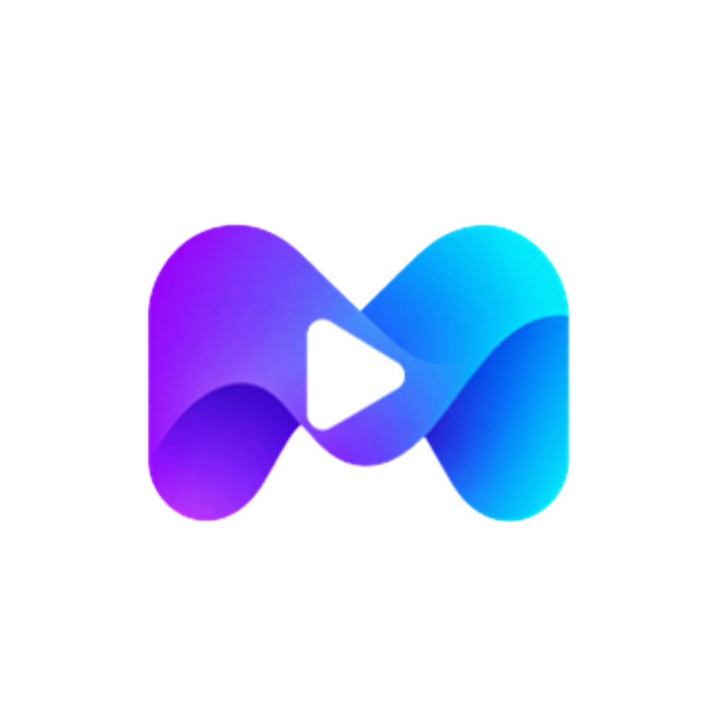

<h1>Morivia <br clear="right" /></h1>

A personal media app for Android phones and tablets, iPhone and iPad.
Bring your own sources: Morivia turns your addons into a library with artwork, profiles, subtitles and your place saved on every device. Licensed GPLv3, like the project it is built on.

**Version <!-- version -->2.0<!-- /version -->** · [Download the latest release](https://github.com/OckePocke9/MoriviaMobile/releases/latest) · [Changelog](CHANGELOG.md)

## What's new in 2.0

Morivia 2.0 is the biggest update yet, the same on phones, tablets, iPhone and iPad.

- **A new look** – the Morivia name and logo everywhere, 31 colour themes with matching app icons, and each profile can have its own theme and icon.
- **New sign-in and profiles** – smooth animations from sign-in to the profile picker to Home, sign-in with a QR code on tablets and iPad, and layouts for phones on their side.
- **A new Home** – a full-screen trailer hero you can swipe (tap the description to read all of it), Continue Watching, a Top Row with ranks, rows from the genres you watch, what aired today, Featured, Live TV and Collections. Home is ready the moment you pick a profile.
- **Settings** – one Connections page for Trakt, Simkl, MDBList and TMDB, with tidier cards and many fixes.
- **For every device** – an APK for every Android phone and tablet, and iPhone and iPad builds again.
- Your profiles, settings, sign-ins, library and downloads move over by themselves when you update.

See the [changelog](CHANGELOG.md) for every change.

## Get Morivia

- **Android phones and tablets** (Android 7.0 or newer): download one APK from the [latest release](https://github.com/OckePocke9/MoriviaMobile/releases/latest), open it and allow the install. New versions install over the old one and keep your data, and the app shows a banner on Home when one is out.
  - `Morivia-Android-X.Y-arm64-v8a.apk` – almost every phone and tablet from about 2017 on. Take this one if unsure.
  - `Morivia-Android-X.Y-armeabi-v7a.apk` – older or low-cost phones, tablets and TV boxes with 32-bit Android.
  - `Morivia-Android-X.Y-x86_64.apk` – Chromebooks with Intel or AMD processors and Android emulators.
  - `Morivia-Android-X.Y-universal.apk` – works on all of them, but is larger.
- **iPhone and iPad:** Download `Morivia-iOS-X.Y-release.ipa` from the same release. Requires iOS or iPadOS 16.1 or newer. Install the unsigned IPA with [Sideloadly](https://sideloadly.io/) on a PC or Mac and sign it with your Apple Account.
- A fresh install starts signed out: sign in with your Nuvio account or continue as a guest.

The app ID is `com.morivia.app`.

## What Morivia does

Morivia is a Kotlin Multiplatform and Compose Multiplatform app with its own look and features:

- **Addon catalogs** – add any Stremio addon by its `manifest.json` link; its catalogs become rows on Home.
- **Home** – a full-screen trailer hero, Continue Watching, a Top Row with ranks, rows from the genres you watch, what aired today, Featured, every addon catalog, Live TV and Collections in one page you scroll freely.
- **Search** – one "Movies and Shows" field across every search-capable catalog, with Trending, genre tiles and Discover by type, catalog and genre.
- **Library** – Recently Added, Movies, TV Shows and Continue Watching in a poster grid, sorted by date added, name or recently watched, with Trakt, Simkl or MDBList as the source if you use them.
- **Profiles** – up to six profiles with their own library, progress, theme, app icon and initials colour, a PIN lock that also protects editing, and a profile picker in the style of the earlier Morivia app.
- **Themes** – Original, 31 Morivia colour themes and a custom colour, AMOLED black, and 31 matching app icons that can follow the theme.
- **Watch Party** – watch together in rooms of up to six, with playback that starts and stays in sync with the host.
- **Accounts and sync** – works as a guest, or sign in with a Nuvio account to sync profiles, library and progress through Nuvio Cloud. Trakt, Simkl, MDBList and TMDB connect with their own accounts or keys.
- **In your language** – the whole app in 31 languages, plus your device language. Addon content keeps its own language.

## Player

- **Playback engines** – Android offers ExoPlayer and mpv. iPhone and iPad use mpv. External playback options vary by platform.
- **Subtitles** – styled subtitles, automatic sync that follows the speech for the whole film, and preferred audio and subtitle languages.
- **Controls** – chapters, playback speed, aspect fit and zoom, picture-in-picture and Continue Watching that remembers where you stopped.

## Build from source

```bash
git clone https://github.com/OckePocke9/MoriviaMobile.git
cd MoriviaMobile
```

Create an empty `local.properties` in the repository root. Optional keys, such as a TMDB key or another sync server, go there and never enter the repository.

Requires Java 21 or newer and the Android SDK (Android Studio is easiest).

```bash
./gradlew :androidApp:assembleFullRelease -Pmorivia.android.distribution=full
```

The APKs (one per processor type and a universal one) are written to `androidApp/build/outputs/apk/full/release/`.

### iPhone and iPad test build

Run the **Morivia iPhone and iPad** workflow by hand in GitHub Actions (Actions, Morivia iPhone and iPad, Run workflow). It builds on GitHub's free macOS runners and saves an unsigned device IPA in the workflow artifacts. To install it, connect your iPhone or iPad to your Windows PC, open the IPA in [Sideloadly](https://sideloadly.io/), and sign in with your Apple Account. A free account can sign the app for seven days at a time.

### Releases

Releases are named **Morivia Android vX.Y** and go up by 0.1 (0.9, 1.0, 1.1 …). The Android APKs are built on a PC, and the iOS IPA is built by hand with the **Morivia iPhone and iPad** workflow in GitHub Actions. Attach the matching IPA with `scripts/publish-release.ps1 -IpaPath <file>`. See [AGENTS.md](AGENTS.md) for the full process.

## Contributors

- [Claude](https://claude.com/claude-code) by Anthropic – builds Morivia: development, design, releases and documentation
- [OckePocke9](https://github.com/OckePocke9) – owner

## License

[GNU General Public License v3.0](LICENSE). Morivia is a modified version of the open-source [Nuvio Mobile](https://github.com/NuvioMedia/NuvioMobile) and keeps its authors' copyright and third-party notices, as the license requires. Sign-in and sync use Nuvio's account service.
